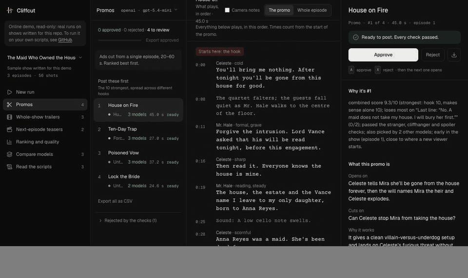
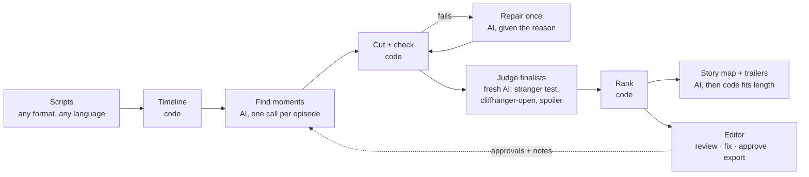
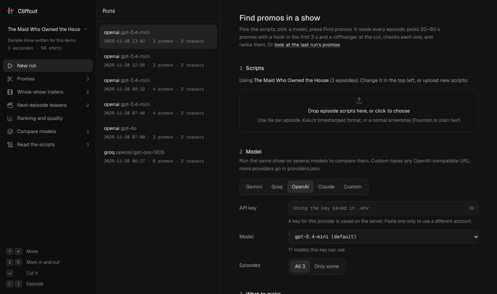
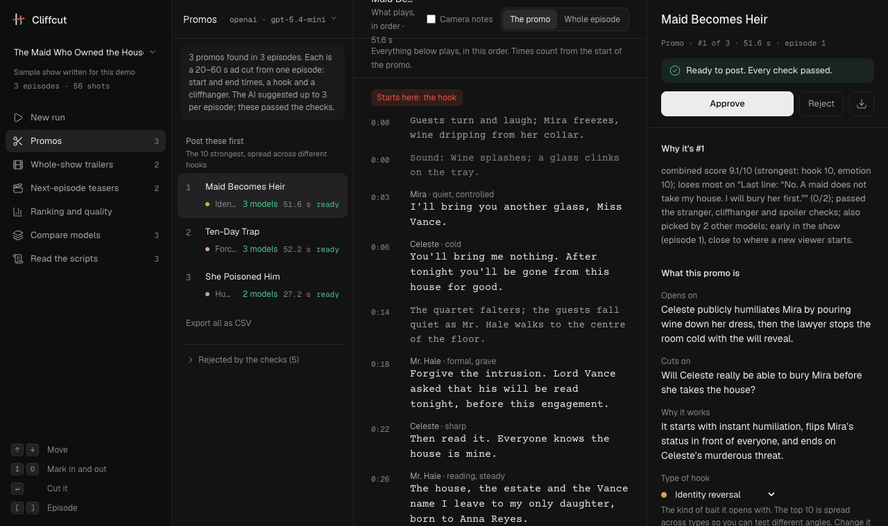
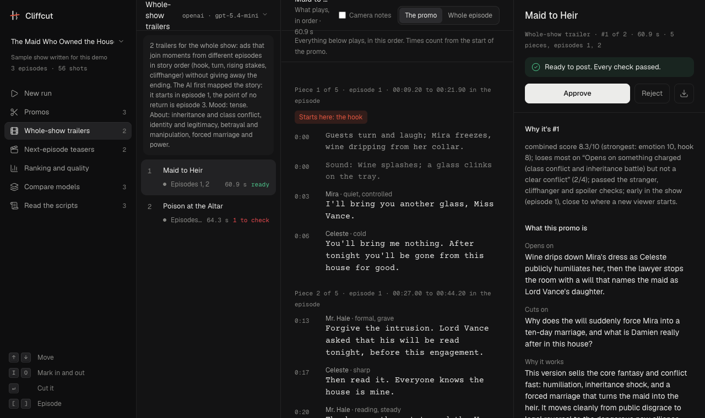
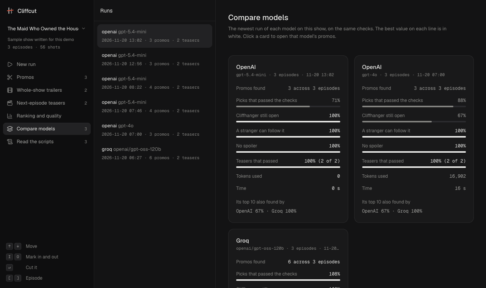

<h1>
   Cliffcut
</h1>

**Finds the promos in a microdrama's scripts: the hook, the cliffhanger, and a clean cut.**

Today an editor watches every episode and picks promo moments by hand, one show at a time, while a new show ships every week. Cliffcut reads every episode's script in about two minutes. It hands the editor a ranked, checked shortlist of ready-to-cut promos, whole-show trailers and next-episode teasers, each with exact timecodes, and exports a cut that Premiere or Resolve opens directly.

Built for Kuku's AI Generalist take-home (Problem 1: *Find the Promos*).



<sub>The demo uses a sample show written for this repo. Kuku's input pack is confidential and is not in this repository.</sub>

---

## What it makes

| Output | What it is | Length | Purpose |
|---|---|---|---|
| **Promos** | One charged moment from one episode: a hook in the first 3 s, cut on an open question | 20–60 s | Pull new viewers in from the feed |
| **Whole-show trailers** | 3–6 moments from different episodes in story order (hook → turn → rising stakes → cliffhanger), built on the show's turning points, never showing the ending | 60–90 s (adjustable) | Sell the whole series |
| **Next-episode teasers** | A "next time on…" clip from episode N+1, played at the end of episode N | 8–20 s | Keep current viewers watching |

Every output comes with the episode and timecodes of each piece, the hook, the cliffhanger, why it works, the type of hook, scores, and pass/fail checks.

## How it works



**The AI does the taste; code guarantees the timing; a second AI checks the first; the editor decides.**

- **The AI names script events, never timestamps.** Code turns them into cut points that never chop a word and never leave a flash frame (a sliver of a shot). Cutting naively on dialogue times breaks about **1 in 10** cuts in these scripts. Cliffcut's cutting code produced **0 bad cuts in 2,974** stress-test cuts on the real show.
- **Checks on every pick:**
  - Code: 20–60 s, hook within 3 s, holds on the reaction, clean cuts.
  - Fresh AI calls: *a stranger can follow it*, *the cliffhanger is still open at the cut*, *no spoiler*.
  - Failures are shown with their reasons, never hidden.
- **Scores are earned, not guessed.** The AI never gives a number. It answers concrete questions with evidence from the script: which conflict it opens on, the exact question left at the cut, whether it needs backstory, whether power shifts. Code awards fixed points for those answers and for what it measures itself: how fast the hook lands, intense emotion tags and actions in the script, how many people speak, whether a lead is in it, the length, and the reaction hold. Every point is shown with its reason, for example *"4/4 Opens on a humiliation at 0.0 s"* or *"0/2 Last line isn't a question"*.
- **Ranking** weighs hook 30%, cliffhanger 25%, makes sense alone 20%, emotion 15%, clarity 10%, with spoilers penalised. Earlier episodes win ties, and the top 10 is spread across hook types (identity reversal, forced marriage, humiliation → revenge, forbidden romance) so a team can test different angles. A **Ranking and quality** page answers the brief's two questions: what to post first and why, and where the tool picks badly.
- **Whole-show trailers** start from a story map: the AI finds the five turning points (opportunity, change of plans, point of no return, major setback, climax) plus mood and themes, then cuts toward the climax without showing it. Code trims over-long pieces in the middle, never at the hook or the final cliffhanger.
- **The editor's voice:**
  - an editor brief ("lead with the revenge arc");
  - Kuku's own categories (Romance, Thriller, Crime, Horror, Fantasy, Drama, Comedy, Mythology), each with its own hook hints;
  - main characters, detected automatically and editable;
  - every approve or reject, with its note, shown to the next run as examples. That is in-context learning: no retraining, and it works with any model.

## The editor screen

| | |
|---|---|
|  |  |
| **New run.** Scripts, model, what to make, category, main characters, editor brief | **The promo, as it plays.** What plays, in order, timed from 0:00, from the hook to "cut here". The right panel says why it's ranked where it is, the reason for every score point, and the checks. "Whole episode" shows it in context |
|  |  |
| **Whole-show trailers** built on the story map, with mood | **Compare models.** Every model on the same checks, and the moments several models agreed on |

- **Watch it (optional).** The scripts are enough. If you also have the episode videos, attach them (they stay on your computer, nothing is uploaded) and the promo plays piece by piece.
- **Shots in this cut.** Untick any shot to drop it, or press "Remove dead air" (shots where nobody speaks and nothing happens). The checks re-run live.
- **Export** an EDL for Premiere or DaVinci Resolve, a CSV, or JSON. "Export all as CSV" gives the raw output for a whole run.
- **Cut by hand:** `I` / `O` mark in and out, `↵` cuts, `[` `]` change episode.

## Any model, any script

- **Models:** Gemini, Groq, OpenAI and Claude (Claude through the official Anthropic SDK), or **any OpenAI-compatible endpoint** pasted into the app (that's how a team plugs in its own model). Adding a provider is one entry in [`providers.json`](providers.json). The model list loads live, and settings a model refuses (such as a custom temperature) are dropped and retried automatically.
- **Scripts:**
  - Kuku's timestamped format is read exactly.
  - Standard screenplays (Fountain or plain text) are read with estimated timing and inferred shots.
  - Anything else is converted by the model.
  - **Hindi and regional languages** work; a Hindi screenplay is in [`samples/hindi`](samples/hindi). Results can be written in English, Hindi, Hinglish, Tamil, Telugu, Bengali or Marathi.

## Works on shows it has never seen

Kuku's interview runs it on a different show, so nothing is tied to this one:

- **Formats:** Kuku's timestamped scripts; screenplays (Fountain, plain text, Final Draft, Word, PDF); subtitles (SRT, VTT). Anything else is converted by the model.
- **Languages:** English, Hindi, Hinglish and regional scripts, with results in any of them.
- **Genres:** hooks are named in each genre's own terms, and intensity comes from moments the model points at, not a drama word list.
- **Missing summaries** are written by the model in the same call.
- **Tested** on an unseen horror show written as subtitle files (in `samples/subtitles-horror`): 2 clean promos and a teaser for about 9k tokens. A Hinglish episode (`samples/hinglish`) gives Hinglish titles, hooks and reasons.

## From timestamps to video

The brief asks for the moments and cut points, so the core output is a cut list: EDL for Premiere and Resolve, CSV, or JSON. Attach the episode videos and **Export → MP4** cuts the promo straight from them, every piece at its exact IN and OUT, joined, vertical 9:16 or the original shape. Straight cuts only, no music or text.

## Cost

New run shows the size before you start (a full 50-episode show is about 100 calls and 400k tokens; 3 episodes about 90k). Answers are cached, so re-running costs nothing. Routine camera notes are dropped from prompts (they were half the script tokens), and an episode is only re-asked when it has fewer than 2 usable promos.

## Results on Kuku's show (50 episodes, OpenAI `gpt-5.4-mini`)

| | |
|---|---|
| Promos ranked | 92–99 across 49 of 50 episodes (about 2 per episode; the top 10 is the "post first" list) |
| Whole-show trailers | 2 that passed every check (72–81 s, 6 moments from 6 episodes) |
| Picks passing the code checks | 74%, after one repair round |
| Cost of a full show | about 120 model calls, about 450–490k tokens, about 2 minutes. Re-runs are cached |
| Models compared | OpenAI on all 50 episodes; Gemini and Groq partly, limited by free-tier quotas (see below) |

## Where it picks badly (honest)

- **Models answer their own cliffhangers.** The judge found that only about half of the finalists still had the question open at the cut. They are pushed down the ranking, not hidden.
- **Models ignore timing rules.** Many first picks are too short, and teasers often show the episode's ending. Code repairs and fits them; a third of teasers still fail and are listed with the reason.
- **Text isn't footage.** A line can read flat and play strong. Without video the tool can't judge acting; the video preview is where a human decides.
- **Whole-show trailers are the hardest case.** Models make pieces far too long (up to 206 s), so code caps them.
- **Free tiers are not production.** Gemini's daily quota ran out partway through 50 episodes, and Groq's 8,000 tokens a minute makes a show take hours.

## Run it

```bash
# backend
python3 -m venv .venv && .venv/bin/pip install fastapi uvicorn httpx python-multipart anthropic pytest
cp .env.example .env            # add the keys you have
.venv/bin/uvicorn server.app:app --port 8790

# frontend
cd web && npm install && npm run dev    # http://localhost:5173
```

Command line:

```bash
.venv/bin/python -m promo.run --show samples/sample-show --provider openai
.venv/bin/python -m promo.run --show "<folder>" --provider custom --base-url https://host/v1 --model <name>
```

Tests (31):

```bash
.venv/bin/python -m pytest -q
```

They cover clean cuts, the full pipeline with replayed model answers, repairs, trailers, the Hindi parser, provider retries and errors, and the server.

## Repository map

| Path | What's there |
|---|---|
| `promo/timeline.py` | Reads Kuku's timestamped format into one timeline of shots, lines, actions and sounds |
| `promo/formats.py` | Screenplay / Fountain / Hindi parsing, and AI conversion of unknown formats |
| `promo/cuts.py` | Clean-cut rules and the code checks |
| `promo/pipeline.py` | Find → cut → repair → judge → rank → story map → trailers |
| `promo/providers.py`, `promo/anthropic_provider.py` | One interface for every model |
| `server/app.py` | FastAPI: shows, uploads, runs, live checks, editor decisions |
| `web/` | The editor (React, Vite, Tailwind) |
| `docs/CLIFFCUT_GUIDE.md` | A full illustrated guide to every screen and decision |
| `DESIGN.md`, `PRODUCT.md` | Design system and product record |

## Built with AI, and where it got it wrong

Built with Claude Code. The models inside the tool are Gemini, Groq, OpenAI and Claude. One place AI got it wrong while building this: it first claimed "88% of dialogue lines start mid-shot, so cutting on dialogue times glitches almost every promo". Testing the cutting code on all 1,487 lines showed the real defect rate is **9.8%**: starting mid-shot is a normal trim, and the real defects are flash frames and chopped words. The figure was true; the conclusion wasn't. The cutting rules were rebuilt around what actually looks broken.
