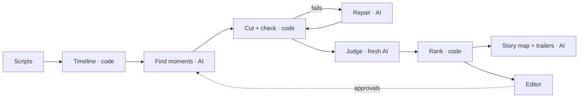

<h1>
   Cliffcut
</h1>

Finds the promos in a microdrama's scripts: the hook, the cliffhanger, and a clean cut.

**Live demo (read-only): [cliffcut.pages.dev](https://cliffcut.pages.dev)**: real runs on shows written for this repo. Running models on your own scripts needs the local app below.


<sub>Demo uses a sample show written for this repo.</sub>

## Outputs

- **Promos:** 20–60 s from one episode, with a hook in the first 3 s and a cut on an open question.
- **Whole-show trailers:** moments from different episodes in story order, never showing the ending. Each must be one story: pieces linked by *but* / *so* (never "and then"), one lead through every piece (checked in code), and a stranger who sees only the trailer must be able to retell it.
- **Next-episode teasers:** 8–20 s clips from episode N+1, played at the end of episode N.

Each comes with timecodes for every piece, the hook, the cliffhanger, why it works, and evidence-based scores and checks. Export as EDL, CSV, JSON or MP4.

## How it works



## Run

```bash
python3 -m venv .venv && .venv/bin/pip install fastapi uvicorn httpx python-multipart anthropic pytest
cp .env.example .env
.venv/bin/uvicorn server.app:app --port 8790
cd web && npm install && npm run dev        # http://localhost:5173
```

```bash
.venv/bin/python -m promo.run --show samples/sample-show --provider openai
.venv/bin/python -m pytest -q
```

Online demo: `cd web && VITE_DEMO=1 npx vite build --outDir dist-demo`, then `.venv/bin/python scripts/export_demo.py web/dist-demo` and `npx wrangler pages deploy web/dist-demo --project-name cliffcut`. It exports only the shows written for this repo.

## Inputs

- **Script formats:** Kuku timestamped scripts, Fountain / plain text, Final Draft, Word, PDF, SRT and VTT. Anything else is converted by a model.
- **Languages:** English, Hindi, Hinglish and regional languages.
- **Models:** Gemini, Groq, OpenAI, Claude, or any OpenAI-compatible endpoint. Add one in [`providers.json`](providers.json).

## Layout

| Path | |
|---|---|
| `promo/` | Parsing, clean cuts, providers, pipeline, scoring |
| `server/` | FastAPI |
| `web/` | Editor (React, Vite, Tailwind) |
| `samples/` | Test shows: English, Hindi, Hinglish; thriller, crime, fantasy, comedy, mythology, horror; Kuku, screenplay, Final Draft, SRT, VTT |
| `tests/` | Tests |
