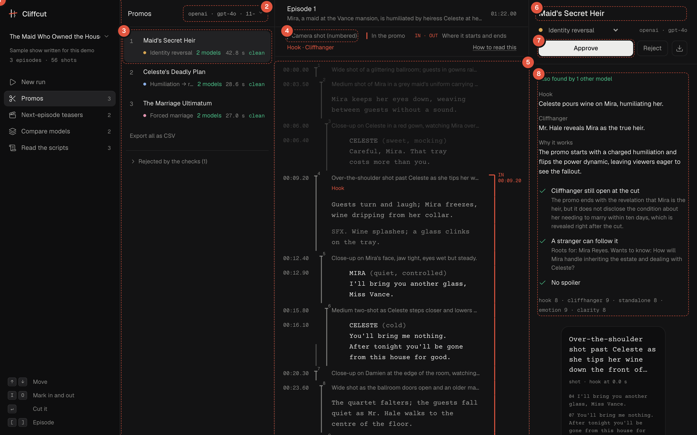
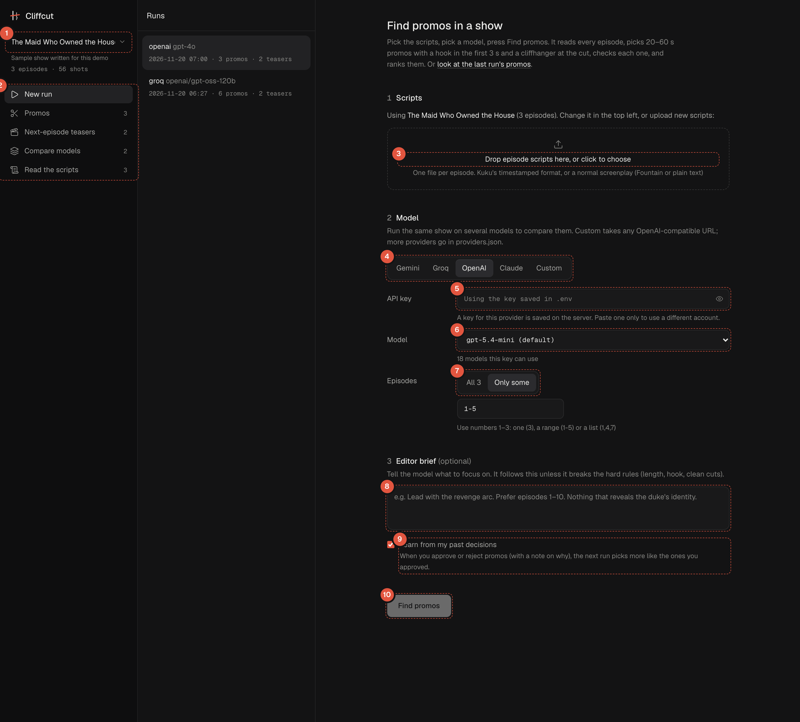
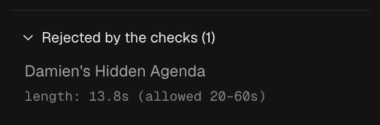
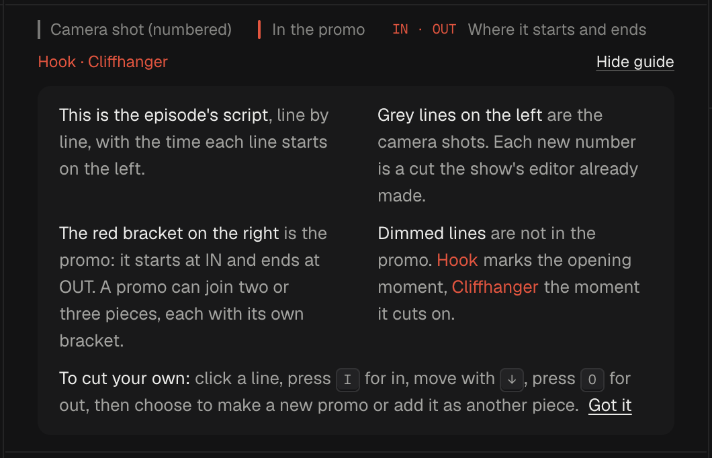
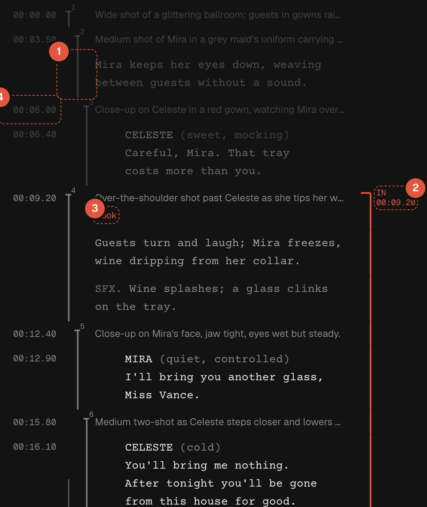
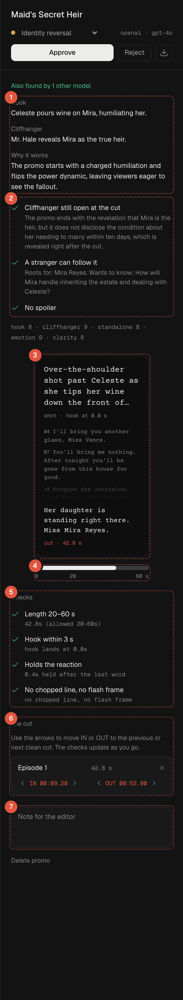
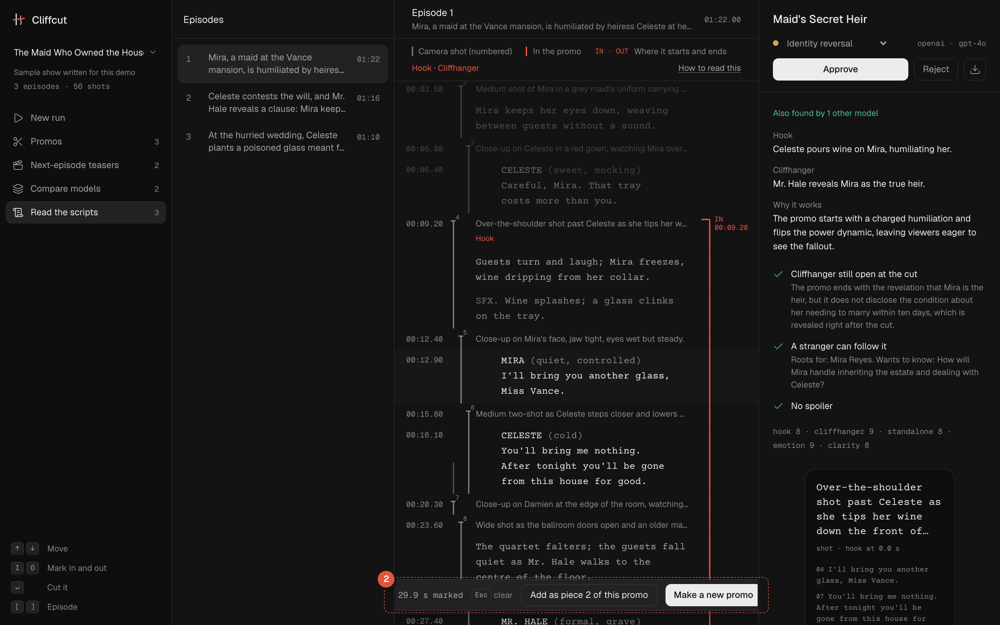
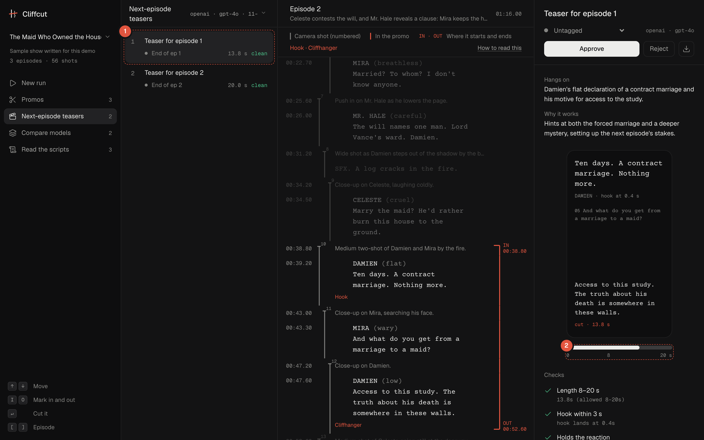
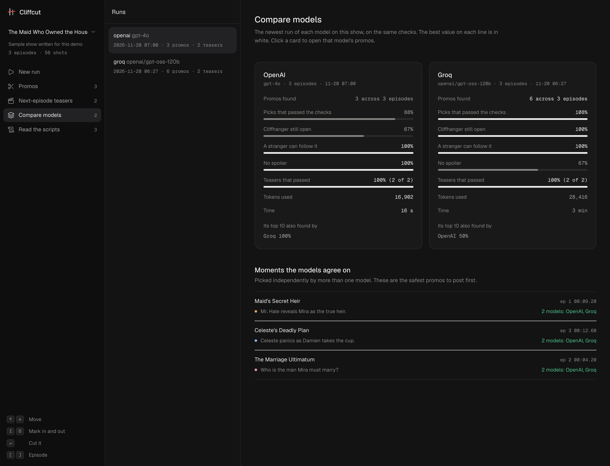
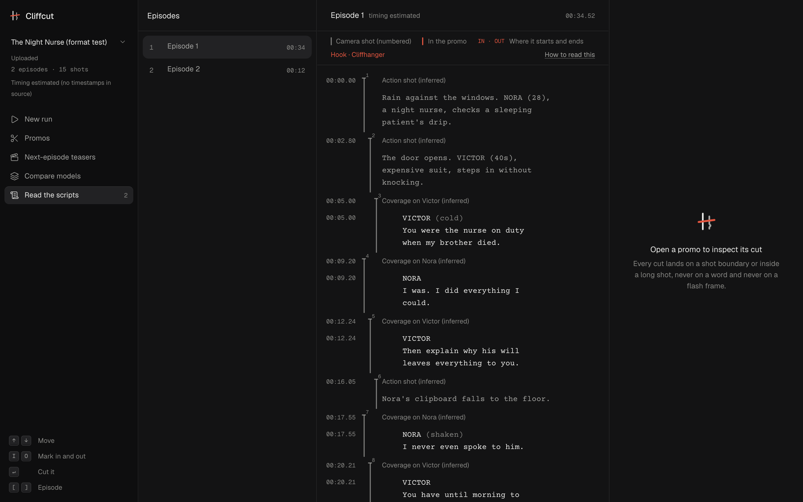

All screenshots use **our own demo show**, *The Maid Who Owned the House*, which we wrote for this project. Kuku's scripts never appear in this document. Red numbered circles in the images match the numbered notes under each image.

# Part 0. Plain answers to the big questions

> **Updated screen (latest):** when you open a promo, the centre now shows **the promo itself**: what plays, in order, timed from 0:00, with "Starts here: the hook" at the top and "Cut here: the cliffhanger" at the end. **Whole episode** shows it in context, with the promo's lines tinted between "Promo starts" and "Promo ends" markers. Camera notes are hidden unless you tick "Camera notes". The older side lines and brackets in some screenshots below are gone.

## "How are the scores decided? They look random."

They were: the AI used to write its own 1–10 numbers. **Now the AI never gives a number.** It answers questions with evidence from the script, and code awards fixed points. Each promo shows every point and its reason.

| Score | Points come from |
|---|---|
| **Stops the scroll (hook)** | Opens on a real conflict (accusation, humiliation, reveal, threat, violence, rejection, confession, betrayal) within 3 s: 4. An intense emotion tag or action in the first 3 s (furious, slaps, gasps): 2. Lands without backstory: 2. First beat within 1 s: 2 |
| **Leaves them hanging (cliffhanger)** | Cuts on a named open question near the end: 4. Last line is a question: 2 (exclamation: 1). Holds on the reaction at least 0.5 s: 2. The judge model confirms the answer comes after the cut: 2 |
| **Makes sense to a stranger** | Stakes stated with no backstory needed: 4. Two or fewer people speak: 3 (fewer points for more). A lead character speaks: 3 |
| **Emotional punch** | Intense beats in the script (emotion tags, slaps, screams, tears): 2 each, up to 6. Someone's power or status flips: 4 |
| **Easy to follow** | Length in the 30–55 s sweet spot: 4. One continuous piece: 3. The judge model says a stranger understood it: 3 |

Each score is out of 10, and the five combine as hook 30%, cliffhanger 25%, makes sense alone 20%, emotion 15%, clarity 10%. *Honest limit:* "makes sense" and "emotion" still come out high for most promos in this show, because the scripts are dense with emotion tags. The point is that every number can now be traced to a line in the script.

## "Doesn't the editor still have to watch everything? Then what does this solve?"

No. That's the whole point.

| | Without Cliffcut | With Cliffcut |
|---|---|---|
| What the editor does first | Watches all 50 episodes, about 100 minutes of footage, scrubbing back and forth for good moments | Nothing. The AI reads all 50 scripts in 1–2 minutes |
| Finding moments | Has to remember or note where every slap, reveal and cliffhanger is | Gets a **ranked shortlist** (about 100 promos for Kuku's show), each with exact start and end times |
| Judging them | By gut, one at a time | Each promo already says its hook, its cliffhanger, why it works, and whether it passed the checks |
| Cutting | Finds the timecodes by hand in Premiere | Exports an **EDL file**: Premiere or Resolve opens it with the cuts already placed |
| What the editor still watches | Everything | Only the few promos they pick to publish, as a final check |

The editor goes from *searching* (hours) to *choosing* (minutes). The research behind this: in the Edinburgh trailer study, a person using a tool like this looked at only about **10% of the film**, finished in 22 minutes, and their trailer was preferred over the fully automatic one 60% of the time. **The AI narrows; the human decides.**

## "Do I need to train an ML model, or use RAG?"

**No training, and no RAG.** Here's what is used instead, and why:

- **Ready-made AI models (LLMs), through their API.** Gemini, Groq, OpenAI or Claude already understand stories, tension and emotion. We don't train anything. We give them clear instructions (the "prompt") plus the script, and they answer. This is the "AI implementation" part of the JD: picking the right model, writing the instructions, and checking the answers.
- **Why not RAG?** RAG (searching a big library and pasting the relevant bits into the prompt) is for when your material is too big to fit in one request. **One episode script is about 2,000 words, so it fits whole.** No search is needed.
- **What we do that is a bit like RAG:** for each episode we also paste in a short "story so far" (the earlier episodes' one-line summaries), the editor's brief, and the editor's past Approve/Reject decisions with their notes. That's called **in-context learning**: the model learns the editor's taste from examples in the prompt, without any training.
- **Where real ML training *would* come in (future work, worth saying in the interview):** Kuku has real ad results (click-through, installs). With a few hundred promos and their results, you could train a small model that predicts which promo will perform best, and use it to rank. That needs data we don't have, so the honest answer is: *"Start with prompting and checks today; train a ranker once real performance data exists."*

## "The red line is one long line. Is it skipping lines in between? How do I know what to keep?"

**Nothing inside the red line is skipped.** Everything from IN to OUT plays, in order, exactly like the episode. One red line is one continuous piece.

To leave something out, the editor decides shot by shot:

- The right panel has **"Shots in this cut"**: every shot inside the red line, with its time, its length, and either **"2 lines spoken"**, **"action, no lines"** or **"dead air"**.
- **Untick a shot** to cut it out. The promo splits into **pieces**, each with its own red bracket, joined together. The checks re-run at once, so if dropping a shot would chop a word, it says so.
- **"Remove dead air"** drops every shot where nobody speaks *and* nothing happens: no line, no action, no sound. A silent slap or a shocked face is not dead air and is kept. In Kuku's show, 11% of all shots (462 s) are true dead air.
- **"Restore the AI's original cut"** undoes your changes.

*Honest note:* my first version counted only spoken lines as "silent", so it cut the wine-spill shot, which is the visual hook. A screenshot caught it, and the rule now needs no line, no action and no sound.

## "Why can I see only one red line when there are several promos?"

The red line shows **the promo you selected**. Other promos in the same episode now show as **thin grey lines** next to it (hover to see their names). Click a promo in the list to make it the red one.

## "Shouldn't a whole-show trailer be longer, 60–80 s, or about 8% of the show?"

Longer, yes, and that's now the default. The brief caps *promos* at 60 s, but whole-show trailers are our extra, and the ad data backs going longer: on DramaBox, ads of 111–116 s got 78% of the reach. You pick the trailer length on New run:

- **45–60 s:** fits the brief's 60 s cap.
- **60–90 s:** the default.
- **90–120 s:** the long "serial" ad.

8% of the whole show would be 8 minutes for a 100-minute show. That's a recap episode, not an ad: ad platforms and viewers won't sit through it. A recap is a different product, possible later.

## "Can the editor say the genre, and which outputs they want?"

Yes. New run now has **"What to make"**:

- **Promos:** always made.
- **Whole-show trailers:** on or off, with the length choice above.
- **Next-episode teasers:** on or off.
- **Genre:** Romance, Revenge, Billionaire romance, Fantasy / werewolf, Thriller, Family drama, Comedy, or "Let the AI work it out". The AI judges hooks the way that genre's audience does.
- **Editor brief:** free text, for anything else ("Lead with the revenge arc").

## "Spoilers: showing the next episode or two is fine"

Agreed, and changed. A promo is only flagged as a spoiler when it gives away a **major twist from much later**: a hidden identity, a death, the ending. Showing what happens in this episode or the next one or two is normal promo material and isn't flagged.

## "Where is the ranking, and where does it say what the tool gets wrong?"

Kuku's brief asks every run two things: *"Rank them: which would you post first, and why?"* and *"Check quality: where does your tool pick badly?"* Both now have their own page, **Ranking and quality**, in the menu:

- **Post these first, and why.** The top 5, each with a plain reason. For example: *"Why #1: combined score 8.8/10 (strongest: hook 9, cliffhanger 9); passed the stranger, cliffhanger and spoiler checks; also picked by 2 other models."* It also lists how the rank is decided.
- **Quality in numbers.** How many the model suggested, the share that passed the code checks, how many needed a repair, cliffhanger-still-open and no-spoiler rates for the judged finalists, and how many teasers passed.
- **Where it picks badly.** Every failure from the run, grouped by kind, with the reason: answered its own cliffhanger, possible spoiler, a stranger couldn't follow it, wrong length, no time for the reaction, teasers that showed the ending. It ends with the blind spots no check can catch.

Each promo's panel also opens with **"Why it's #N"**.

## "Are promos made one episode at a time? The brief says a promo can join moments."

Both happen:

- **Promos** are found **one episode at a time**: the AI reads one episode and suggests up to 3. Reading closely, episode by episode, is what makes the picks precise. A promo can still join **two moments from the same episode** (skipping a slow middle), and you can join more with "Add as piece 2".
- **Whole-show trailers** are the **across-episodes** promos the brief mentions. After all the episodes are read, the AI joins the strongest moments from different episodes, in story order. Set their length to **45–60 s** on New run and they fit the brief's 20–60 s promo rule exactly; the longer settings (60–90 s, 90–120 s) are an extra.

## "The editor has raw footage. How do they use the red line?"

The script's times **are** the episode video's timecodes: the scripts were timed to the edit. So the red line's IN and OUT point straight into the footage. There are three ways to use them:

1. **Watch it inside Cliffcut (optional).** Kuku's pack has scripts only, and they're enough to find promos. An editor who has the episode video files can click **"Attach episode videos"** in the right panel and pick the episode files (name them with the episode number, like `ep03.mp4`). Press play: Cliffcut plays the actual promo, piece 1 from its IN to its OUT, then piece 2 from its episode, and so on, in a 9:16 frame like a phone. **The files stay on your computer; nothing is uploaded.** Tested with timecoded test videos: piece 1 started at exactly episode 1, 00:23.60 (its IN), then jumped to episode 2, 00:22.40 (piece 2's IN).
2. **Export the EDL.** Premiere or DaVinci Resolve opens it with every piece already placed on the timeline from the episode files. The editor only adds polish.
3. **By hand.** Read IN and OUT (for example 01:29.30 → 01:58.40) and set those points in any editor.

The red line is for *reading and choosing*; the video preview is for *watching*; the EDL is for *finishing*.

## "Use Kuku's own categories, and count wordless moments"

- **Category** on New run now lists Kuku's fiction categories: Romance and love, Thriller and suspense, Crime, Horror and supernatural, Fantasy and sci-fi, Drama and family, Comedy, Mythology and religion. Each tells the AI what usually hooks that audience. Horror, for example, means "hold the dread, never show the monster fully"; comedy means "end on the setup of the punchline". These hints are a simple list in the code that the team can edit.
- Kuku's non-fiction categories (finance, self-help, history and so on) are audio courses and stories, not screenplays with scenes, so they don't apply to promo cutting. They'd need a different tool (pull-quotes, not cliffhangers).
- **Wordless moments count.** The AI is now told that an action or sound line (a slap, a kneel, a ring offered, a gasp) can be the hook or the cliffhanger with no dialogue, and to use the emotion tags (Furious, Trembling, Cold) to judge how charged a moment is. Short promos often work best on one wordless beat plus one line.

## "Which text is in the promo? Some is white, some grey."

- **Faded (see-through) lines** are outside the promo.
- Inside the red line **everything plays**, but the kinds of line look different:
  - **"Camera: …"** in small grey describes what the shot shows. It's a direction, not something spoken.
  - **"Action"** lines (what people do) are white, like dialogue, because they matter just as much.
  - **"Sound"** lines are light grey.

## "Main characters, turning points and mood"

- **Main characters** are found in the scripts automatically: who appears in the most episodes (on Kuku's show: Juliana, Alexander, Catherine). They're shown on New run and can be edited. Promos and trailers are told to centre on them, because viewers follow the leads.
- **Story map before trailers.** Like the trailer research (Papalampidi et al.), the AI first finds the show's five turning points (opportunity, change of plans, point of no return, major setback, climax), plus its mood and themes. Trailers are built from those turning points up to the climax, never including it. On Kuku's show it found: starts in episode 1, point of no return in episode 4, major setback in episode 41, climax in episode 45. Mood: dark, tense, romantic, vengeful. Themes: betrayal and redemption, class, love and loyalty, abuse of power. The trailers tab shows this map.
- **A flash of emotion.** Trailers may open with 2–3 flashes of 1–2 seconds (a gasp, a slap, a tear) before the story beats, a burst of feeling that pulls you in before you know why.

## "It must work in Hindi and regional languages"

It does:

- **Scripts in any language** are read. Hindi (Devanagari) screenplays work: character names have no capital letters, so a short name on its own line above the dialogue is read as the speaker. Tested on a Hindi sample script (`samples/hindi/`), with speakers, emotions and lines all read correctly.
- Kuku's timestamped format also accepts Hindi labels (कैमरा, एक्शन, साउंड).
- Anything unusual goes to the AI to convert, and modern models read Hindi, Hinglish, Tamil, Telugu, Bengali and Marathi.
- **"Write results in"** on New run sets the language of the titles, hooks and reasons: English, Hindi, Hinglish, Tamil, Telugu, Bengali or Marathi.

## "What about a promo for the whole season? Is that in the brief?"

Yes. The brief says a promo *"can also join a few moments, from one episode or across several"*. Cliffcut makes **three kinds of output**, each in its own tab:

| Output | What it is | Length | Who it's for |
|---|---|---|---|
| **Promos** | One strong moment from one episode (a slap, a reveal), with a hook and a cliffhanger | 20–60 s | New viewers scrolling a feed |
| **Whole-show trailers** | 3–4 moments from **different episodes**, in story order: hook → turn → rising stakes → cliffhanger. Sells the whole series, never shows the ending | 45–60 s | New viewers; the "season promo" |
| **Next-episode teasers** | A "next time on…" clip from episode N+1, played at the end of episode N | 8–20 s | Current viewers, so they keep watching |

The whole-show trailers follow the shape of the ads that win for DramaBox: an impossible relationship, a betrayal, a secret that shifts power, then a cut before the answer. If a trailer comes back a few seconds too long, code trims the **middle** pieces and never touches the opening hook or the final cliffhanger.

On Kuku's show, the first run made 2 trailers that passed every check, for example "Altar to Ashes" (episodes 1, 3 and 4, 58 s). On our 3-episode demo show, every trailer got flagged as a possible spoiler: with only 3 episodes, a trailer can't avoid the finale. That's the check doing its job.

## "What does '12 promos, 4 teasers' mean?"

It's what one run found. In your example, the run covered **5 episodes**:

- **12 promos:** the AI suggested up to 3 moments per episode (15). The checks removed the weak ones (wrong length, late hook, bad cut), and **12 passed**, about 2 per episode.
- **4 teasers:** one per episode from episode 2 to 5. Each is cut from that episode and plays at the end of the one before it. Episode 1 has no teaser because nothing comes before it.
- **Whole-show trailers:** built once a run has promos from at least 3 episodes.

Each list now opens with a short box that explains its numbers in plain words.

## "Why 100 promos for 50 episodes?"

Nobody is meant to post 100. Here's where the number comes from and how to use it:

- For each episode the AI suggests **up to 3** moments, so there are about 150 candidates across 50 episodes.
- The checks throw out the ones that are too short or too long, have a late hook, or cut badly. **About 2 per episode survive**, which gives roughly 100.
- They're **ranked**, so the list is a menu, not a to-do list. The screen now shows it in two parts:
  - **Post these first:** the top 10, spread across different hook types.
  - **More options:** the rest, hidden until you click. Useful when the first ads wear out (ads stop working after a few weeks) or to test a new angle.
- Why keep them all? Kuku asked for the **raw output on all 50 episodes**, and real apps rotate many ad cuts a month. ReelShort put out 400+ a day.

## "What is the red line?"

The **red line is the promo**. Imagine the episode as a video: the red bracket beside the script marks the part that will be cut out and used as the ad.

- **IN** is where the ad starts, **OUT** where it ends, with exact times.
- Everything **inside** the bracket is in the ad. Everything **outside** is dimmed, because it isn't.
- If a promo has two pieces, for example skipping a slow middle, there are two brackets.

The grey vertical lines on the left are the **camera shots** that already exist in the episode. The red line always starts and stops at sensible points (never in the middle of a word, never on a tiny flash of a shot), which is why there's a red line *and* grey lines to compare against.

## "What is that dropdown (Identity reversal, Forced marriage…)?"

It's the promo's **hook type**: what kind of story bait opens it. These four are the hook types that research on microdrama ads (AppGrowing, 500+ ads) found most common:

| Hook type | What the viewer sees | Example from our demo show |
|---|---|---|
| Identity reversal | Someone looked down on is secretly powerful or rich | The maid is revealed as the true heir |
| Forced marriage | A contract, deal or forced wedding | Mira must marry within 10 days to keep the house |
| Humiliation → revenge | Someone is publicly shamed, so we want payback | Wine poured on the maid at the party |
| Forbidden romance | Love that isn't allowed | (not in our demo show) |
| Untagged | None of the above | The poisoned cup at the wedding is closer to this, or "danger" |

**Why it matters:** apps test several angles at once and keep what works. Cliffcut spreads the top of the list across types, so Kuku gets one promo of each angle to test, not ten of the same kind. **The AI guesses the type, and the editor can correct it with this dropdown.** In the screenshot above, the AI tagged the poison scene "Humiliation → revenge", which is arguably wrong; that's exactly what the dropdown is for.

## "Why does that hook work? Why is this promo better than another?"

Take the promo in the screenshot (poisoned cup, episode 3):

- **Hook, "Celeste poisons the cup":** in the first seconds the viewer **sees something the characters don't**: powder going into the bride's cup. Writers call this *dramatic irony*. The viewer is instantly tense and wants to shout a warning. That's what stops a scroll.
- **Cliffhanger, "Damien takes the cup":** the promo cuts **right as he drinks**. Will he die? Did he know? The answer is in the next scene, which the promo doesn't show, so the only way to find out is to install and watch.
- **Why it works, in one line:** danger the viewer can see, then a cut before the consequence.

**How the tool decides one promo is better than another** (not just the AI's say-so):

1. **The picking AI scores it 1–10** on five things: hook, cliffhanger, makes sense alone, emotion, clarity. The scores are combined with weights: hook 30%, cliffhanger 25%, makes sense alone 20%, emotion 15%, clarity 10%.
2. **Separate AI checkers can pull it down:**
   - the answer is already inside the promo: −2;
   - it spoils a later twist: −3;
   - a stranger can't follow it: −1.5;
   - a bored viewer would swipe away before halfway: −1.
3. **The code checks must pass** (length, hook within 3 s, clean cuts). Otherwise it never reaches the list.
4. **"Also found by 1 other model"** is extra confidence: two different AIs picked the same moment independently.
5. **Variety:** if the top of the list already has two humiliation promos, a third is pushed down so other angles get a turn.

So "better" means a higher combined score that survived independent checks, not one AI's opinion. The honest limit: these are judgments from reading the script. **Real proof is ad performance** (click-through, installs), which is why the editor's approve/reject feedback, and later real ad data, feed back in.

## "How does this actually help the editor find the best moments?"

The brief describes today's process: *"an editor watches every episode and picks promo moments by hand, one show at a time, and we release new shows every week."*

Here's the editor's day with Cliffcut, for a new 50-episode show:

1. Drop in the 50 scripts and press Find promos. **About 2 minutes**, no watching.
2. Open **Promos → Post these first**. Each of the 10 shows, in plain words, what it opens on, what it cuts on, why it works, its scores, and a status line: **"Ready to post"** or **"Needs a look"** with the reason.
3. Click one. The script jumps to it with the red bracket, so the editor reads the 30 seconds that matter instead of watching 100 minutes.
4. Approve, add a one-line note, and export the EDL. Premiere opens it with the cut already placed.
5. Do the same for 1–2 **whole-show trailers** and the **teasers**.
6. Next week's show: the run already knows this editor's taste from their notes.

**Searching a whole show takes hours; choosing from a ranked, checked shortlist takes minutes.** That is the problem in the brief, solved for every new show, every week.

# Part 1. The problem, in one page

## What Kuku asked for (the take-home, Problem 1: Find the Promos)

- Kuku gave us **50 episode scripts** of one microdrama. Every shot, action, line and sound has a start and end time.
- They want a tool that finds the best **promos**: 20–60 second clips to post on Instagram, TikTok and YouTube.
- A good promo has:
  1. a **hook in the first 3 seconds**;
  2. a **cliffhanger** at the end (cut before the answer);
  3. it **makes sense to a stranger**.
- For each promo: the episode(s), the start and end time of every piece, the hook, the cliffhanger, and one line on why it works.
- Also: a **ranking**, an honest **where it fails** section, and a **prototype anyone can open**.
- In the interview they will run it on **a new script**, maybe with **their own AI model**.

## What the JD is really testing

The AI Generalist JD describes the job as **50% AI implementation, 30% problem discovery, 20% execution and operations**. It asks you to:

| The JD says | Where Cliffcut shows it |
|---|---|
| "Work with content and growth teams… find the problems most worth solving" | Promo cutting is a real growth bottleneck: microdrama apps run thousands of ad cuts a month, and the best are cut straight from episodes (research in the notes doc, section 11). |
| "Build practical solutions: tools, AI workflows… starting small" | A working tool with four steps: Upload → Run → Review → Export (Part 3). |
| "Choose the right models and tools, test whether the output is good, and know when a simpler solution is better" | Swappable models (Gemini, Groq, OpenAI, Claude, any URL); a model comparison screen; AI does the taste, **plain code does the timing**, because code is better at it (Part 4). |
| "Drive adoption… keep improving based on feedback" | An editor screen built for a non-technical person; Approve and Reject with notes **teach the next run** (Part 3.3). |
| "Share what you learn" | Every mistake AI made is logged with how we caught it (notes doc, section 9). |
| "You like figuring out why something is hard" | The overlap problem: cutting on dialogue times breaks about 1 in 10 cuts, so we built clean-cut rules and tested them on all 1,487 lines (Part 4). |

# Part 2. The screen at a glance

{width=100%}

Cliffcut is laid out like a professional editing tool, in four columns:

1. **Left rail (1).** The product logo, which show you're working on, the menu, and keyboard shortcuts.
2. **List column (3).** What you're browsing: promos, teasers, runs or episodes. **(2)** picks which AI run's results you see.
3. **The script (4, 5).** The centre of the screen: the episode's script, with the promo drawn on it in red pencil. **(4)** is the always-visible legend.
4. **Inspector (6, 7, 8).** Everything about the selected promo: its name and type, Approve or Reject, why it works, the checks and the preview.

The look is called a **lined script**. On a real film set, the script supervisor draws vertical lines down the script to show which camera shot covers which lines. Cliffcut uses the same idea, so you can *see* exactly where a promo cuts.

# Part 3. Every screen, in detail

## 3.1 New run: where a tester starts

{width=100%}

This screen opens first, because someone testing the tool wants to try it straight away.

1. **Show picker.** Which show you're working on. It's grouped into **Demo show** (ours, public), **Kuku's show** (private; on a hosted link it needs a passcode) and **Your uploads**.
2. **Menu.** New run, Promos, Next-episode teasers, Compare models, Read the scripts.
3. **Upload.** Drop one file per episode. Two formats work:
   - Kuku's timestamped format, which is read exactly;
   - a normal screenplay (Fountain or plain text), where there are no times, so timing is **estimated** from word counts and the screen says so.

   Anything else is converted by the AI model. This is how the tool handles a **new input** in the interview.
4. **Provider.** Gemini, Groq, OpenAI, Claude, or **Custom**, where you paste any OpenAI-compatible URL. That's how Kuku can plug in **their own model**.
5. **API key.** It's hidden, and the eye button shows it. If a key is already saved on the server, the box says so. A typed key is used for that run only and never saved.
6. **Model.** A dropdown of the models your key can actually use, loaded live, with the default marked.
7. **Episodes.** "All 50", or "Only some": one (3), a range (1-5) or a list (1,4,7). A few episodes is a quick test.
8. **Editor brief (optional).** Plain English, for example "Lead with the revenge arc. Nothing that reveals the duke's identity." The AI follows it unless it breaks the hard rules.
9. **Learn from my past decisions.** Every Approve or Reject you've made, with your note, is shown to the AI as examples of your taste. It picks more like what you approved, without retraining.
10. **Find promos.** Starts the run. A progress bar shows each stage: reading episodes, joining moments across episodes, checking finalists.

## 3.2 Promos: the ranked list

On the list (number 3 in the main screenshot), each row shows:

- **The rank** (1 = post first) and **the name** the AI gave the promo.
- **A coloured dot plus the hook type.** Each hook type gets the colour of a screenplay revision page:

  | Hook type | Colour |
  |---|---|
  | Identity reversal | gold |
  | Forced marriage | pink |
  | Humiliation → revenge | blue |
  | Forbidden romance | green |

  These come from industry research on what microdrama ads use. The ranking spreads across types, so a show can test several angles.
- **"2 models"** (green): this exact moment was also picked by another AI model on its own. Those are the safest bets.
- **The length** in seconds.
- **"clean"** (green) or **"2 failing"** (red): whether it passes the automatic checks.

Under the list:

- **Export all as CSV:** the raw output Kuku asked for, every promo with its times, hook, cliffhanger and why.
- **Rejected by the checks:** everything the AI suggested that failed, with the reason. Nothing is hidden.

{width=60%}

## 3.3 The script view: how to read it

{width=100%}

The legend is always on screen. "How to read this" opens the guide above; it opens by itself on the first visit.

{width=75%}

1. **Grey vertical line = one camera shot.** The small number at its top is the shot number. Each new number is a cut the show's own editor already made. Neighbouring shots sit in different lanes so you can tell them apart. A short second line means a voice carries over into the next shot (editors call that an L-cut).
2. **Red line on the right = the promo.** It starts at **IN** and ends at **OUT**, each with its exact time. A promo can join two or three **pieces**, and each piece gets its own bracket.
3. **Hook** marks the opening moment (it must land within 3 seconds). **Cliffhanger** marks the moment it cuts on.
4. **Timecode** on the left: when each line starts in the episode (minutes:seconds).

Lines outside the promo are **dimmed**, so the promo stands out.

**Why it's built like this:** in these scripts, lines, actions and shots overlap in time. Cutting exactly where a line starts or ends causes a visible glitch on about **1 in 10** lines:
- a **flash frame**, a sliver of a shot under 0.7 s;
- a **chopped word** from another speaker;
- or no time to show the reaction.

So the AI only *points* at lines, and code picks a cut point with no flash frame and no chopped word, holding on the reaction. Tested on 2,974 cuts across all 50 episodes: **0 bad cuts**.

## 3.4 The inspector: everything about one promo

{width=45%}

At the top: **the title** (click to rename), **the hook type** (change it in the dropdown), which model found it, and **Approve / Reject / Export**.

- **Approve** is disabled while any check fails, and the screen says which.
- **Export** gives an **EDL** (a file Premiere or DaVinci Resolve opens as a cut), a CSV or a JSON.

1. **Hook, Cliffhanger, Why it works.** The AI's own explanation, in one line each.
2. **The AI checks.** Separate AI calls test every finalist:
   - **Cliffhanger still open at the cut.** A second model sees what happens *after* the cut and confirms the answer isn't inside the promo.
   - **A stranger can follow it.** A fresh model that knows nothing about the show says who it roots for and what it wants to know. If it can't, the promo fails.
   - **No spoiler.** It checks against the whole series that no later twist leaks.
   - Below those, the AI's scores out of 10: hook, cliffhanger, standalone, emotion, clarity.
3. **Phone preview.** The promo as a viewer meets it, in a 9:16 frame: the hook moment at the top, the lines in between, and the cliffhanger line at the bottom with the total length.
4. **The clock.** 0 to 60 seconds. The shaded part is the allowed 20–60 s window, the bar is this promo's length (red if outside the window), and the red tick is where the hook lands.
5. **The code checks**, re-run live on every edit:
   - **Length:** 20–60 s for promos, 8–20 s for teasers.
   - **Hook within 3 s.**
   - **Holds the reaction:** at least a beat of the face after the last word.
   - **No chopped line, no flash frame.**
6. **The cut.** Each piece with its IN and OUT. The ‹ › arrows move a cut to the previous or next clean cut point, and the checks update immediately.
7. **Note for the editor.** Free text. When you Approve or Reject, this note is saved and **teaches the next run** why.

## 3.5 Cutting a promo by hand

{width=100%}

A human can make or fix promos without AI:

1. Click any line in the script.
2. Press **I** to mark where it starts (In), move with **↓**, press **O** to mark where it ends (Out). A dashed red line shows the marked range.
3. The bar at the bottom **(2)** shows the marked length. Choose **Make a new promo**, or **Add as piece 2 of this promo** to join it onto the open one. **Esc** clears the marks.

The same checks run on hand cuts. **[** and **]** jump between episodes.

## 3.6 Next-episode teasers: our extra

{width=100%}

Kuku asked only for promos, which bring **new** viewers in. We added a second output that keeps **current** viewers watching:

- One teaser per episode, **8–20 s**, cut from the **next** episode, played at the end of this one ("next time on…").
- **(1)** "End of ep 1" means this teaser plays after episode 1, using a moment from episode 2.
- **(2)** The clock scales to 20 s.
- An extra check: **it never shows the next episode's ending.**

Retention is where microdrama apps earn their money (pay-per-episode unlocks).

## 3.7 Compare models

{width=100%}

Each card is the newest run of one model on this show, scored on the same checks:

| Line | What it means |
|---|---|
| Promos found | How many passed every check, and across how many episodes |
| Picks that passed the checks | Of everything the model suggested, the share that was the right length, hooked in 3 s and cut cleanly |
| Cliffhanger still open | Of the checked finalists, the answer comes after the cut |
| A stranger can follow it | A fresh model understood it with no context |
| No spoiler | No later twist given away |
| Teasers that passed | Teasers that met all the teaser rules |
| Tokens used, Time | Cost and speed for the whole show |
| Its top 10 also found by | How often another model independently picked the same moments |

The best value on each line is in white. Below the cards, **Moments the models agree on** lists promos that several models picked on their own; they're the safest to post first. Runs that failed are listed separately with the reason.

## 3.8 Read the scripts, and any format

{width=100%}

"Read the scripts" lists every episode with its one-line summary and length. Click one to read its lined script.

This screenshot is our **format test**: a script written as a normal screenplay, with no timestamps. Cliffcut still read it. Timing is **estimated** (the header says "timing estimated"), and shots are inferred: a new shot for every action paragraph and every change of speaker.

# Part 4. What happens when you press "Find promos"

| Step | Who does it | What happens | Why that way |
|---|---|---|---|
| 1. Read | Code | The scripts become one timeline of shots, lines, actions and sounds. Unknown formats go to the AI to convert. | Reading times is exact work; code can't misread it. |
| 2. Find | **AI**, one call per episode | Suggests up to 3 promos and 1 teaser, naming lines by ID, never by time. It also gets the story so far, your brief and your past decisions. | Choosing what grabs a stranger is taste, which AI is good at. Asking for line IDs, not times, stops it inventing timestamps. |
| 3. Cut and check | Code | Turns line IDs into clean cut times and runs the code checks. | Models are bad at timing: 9 of 12 first picks on Groq failed length. Code never is. |
| 4. Repair | **AI**, only if needed | A failed pick goes back once, with the exact reason ("14.2 s, must be 20–60"). | One cheap retry fixes most failures. |
| 5. Join | **AI**, one call | Tries promos made of moments from different episodes. | The brief allows it. It's the hardest case and rarely survives the checks yet. |
| 6. Judge | **AI**, fresh calls | Stranger test, cliffhanger-open test and spoiler test on the finalists. | A second opinion catches what the picker missed: on OpenAI, half its finalists answered their own cliffhanger. |
| 7. Rank | Code | Weighted score, minus penalties from the judges. Earlier episodes win ties, duplicates are dropped, and hook types are spread out. | The final list is fair, varied and explainable. |

**Swapping models:** every model sits behind one interface, so changing models is a setting, not new code. Claude uses Anthropic's official SDK. Everything else uses the OpenAI-compatible API that Gemini, Groq and OpenAI all offer. A new provider is one entry in `providers.json`.

# Part 5. Words used on screen

| Word | Meaning |
|---|---|
| Promo | A 20–60 s ad clip for strangers, made of one to three pieces |
| Teaser | An 8–20 s "next time" clip from the next episode, for current viewers |
| Piece | One continuous stretch of an episode inside a promo |
| IN / OUT | Where a piece starts and ends |
| I / O | The keys you press to mark In and Out |
| Hook | The opening moment; it must land within 3 s |
| Cliffhanger | The open question the promo cuts on, before the answer |
| Camera shot / coverage line | A grey vertical line, one per shot; the number is the shot number |
| Flash frame | A sliver of a shot under 0.7 s at a cut; it looks like a glitch |
| L-cut | A voice that carries on over the next shot |
| clean / failing | Passes all the code checks / how many checks it fails |
| 2 models | Another AI model picked the same moment independently |
| Run | One pass of one AI model over a show |
| EDL | Edit Decision List, a file video editors open as a ready cut |

# Part 6. Showing it in the 3-minute video, and to Kuku

1. **Open the app.** The logo draws itself and New run opens. Say what it does in one line.
2. **Upload** the screenplay-format test script, pick a model, Only some → 1-2, **Find promos**, and show the progress.
3. **Promos:** open #1, read out its hook and cliffhanger, and point at the red bracket on the script.
4. **Fix a cut:** press ‹ on OUT until "Length" turns red, then › to make it green again. Approve with a note.
5. **Compare models:** the cards, then "moments the models agree on".
6. **Teasers:** the extra output for retention.
7. **Close** on the one place AI got it wrong (cutting on dialogue times, the real number is 1 in 10, not 88%), and how the tool now protects against it.

**What makes it hireable, in one sentence:** *the AI does the taste, code guarantees the timing, a second AI checks the first, a human has the final say, and every model and mistake is visible.*
